<!-- ═══════════════════════════════  HEADER  ═══════════════════════════════ -->
<div align="center">


<a href="https://umidjon.dev">
  
</a>

<br/><br/>

<a href="https://umidjon.dev"></a>
<a href="mailto:umidjongafforov844@gmail.com"></a>
<a href="https://www.linkedin.com/in/umidjon-gafforov-8b151b325"></a>
<a href="https://t.me/umidjon_developer"></a>
<a href="https://instagram.com/umidjon_developer"></a>

<br/>


</div>


<!-- ═══════════════════════════════  ABOUT  ═══════════════════════════════ -->

## 👨‍💻 About Me

<table>
<tr>
<td width="58%" valign="top">

I'm a **Full Stack & Mobile Developer** from **Tashkent, Uzbekistan 🇺🇿** with **3+ years** of turning ideas into fast, scalable and beautifully crafted products — from high-converting landing pages to production-grade platforms used by real customers.

- 🔭 Building freelance **web & mobile** products for clients worldwide
- 🧠 Deepening **backend architecture** & **system design**
- 🎨 Obsessed with **clean code**, **performance** & **premium UI/UX**
- 🏆 AI hackathons participant · **UZ Combinator** founders camp alumni
- 💬 Speaks **Uzbek · Russian · English**
- ⚡ Replies within **24 hours**

</td>
<td width="42%" valign="top">

```ts
const umidjon = {
  role:      "Full Stack & Mobile Dev",
  location:  "Tashkent 🇺🇿 · Remote 🌍",
  experience:"3+ years",
  frontend:  ["React", "Next.js", "Vue", "Nuxt"],
  mobile:    ["React Native", "Expo"],
  backend:   ["Node.js", "NestJS", "FastAPI"],
  databases: ["PostgreSQL", "MongoDB", "Supabase"],
  motto:     "Clean code. Fast apps. Real results.",
  available: true,
};
```

</td>
</tr>
</table>


<!-- ═══════════════════════════════  WHAT I BUILD  ═══════════════════════════════ -->

## 🚀 What I Build

<table width="100%">
<tr>
<td width="33%" align="center" valign="top">

<h3>🌐 Web Apps</h3>
<sub>SaaS dashboards, marketplaces, landing pages & business sites — SEO-ready, blazing fast, pixel-perfect.</sub>
</td>
<td width="33%" align="center" valign="top">

<h3>📱 Mobile Apps</h3>
<sub>Cross-platform iOS & Android apps with React Native / Expo — App Store & Play Store ready.</sub>
</td>
<td width="33%" align="center" valign="top">

<h3>⚙️ Backend & APIs</h3>
<sub>Scalable REST & GraphQL APIs, auth, payments, real-time & cloud deployment.</sub>
</td>
</tr>
</table>


<!-- ═══════════════════════════════  TECH STACK  ═══════════════════════════════ -->

## 🛠️ Tech Arsenal

<div align="center">

<table>
<tr>
<td align="center" width="140"><b>Languages</b></td>
<td></td>
</tr>
<tr>
<td align="center"><b>Frontend</b></td>
<td></td>
</tr>
<tr>
<td align="center"><b>Mobile & Desktop</b></td>
<td></td>
</tr>
<tr>
<td align="center"><b>Backend</b></td>
<td></td>
</tr>
<tr>
<td align="center"><b>Databases</b></td>
<td></td>
</tr>
<tr>
<td align="center"><b>DevOps & Tools</b></td>
<td></td>
</tr>
<tr>
<td align="center"><b>AI / ML</b></td>
<td></td>
</tr>
</table>

</div>


<!-- ═══════════════════════════════  PROJECTS  ═══════════════════════════════ -->

## 📌 Featured Projects

> ✨ Full case studies with screenshots & results → **[umidjon.dev](https://umidjon.dev)**

<!-- TODO: replace "Project Name", descriptions, stacks and links with real ones.
     Tip: add a screenshot per project →  at the top of each cell. -->

<table width="100%">
<tr>
<td width="50%" valign="top">

### 🏷️ Project Name
<sub>Booking platform serving **500+ users/month** with real-time availability & online payments.</sub>


<a href="#"><b>🔗 Live Demo</b></a> &nbsp;•&nbsp; <a href="#"><b>📂 Case Study</b></a>

</td>
<td width="50%" valign="top">

### 📱 Project Name
<sub>Cross-platform mobile app on **iOS & Android** with push notifications & offline mode.</sub>


<a href="#"><b>🍎 App Store</b></a> &nbsp;•&nbsp; <a href="#"><b>🤖 Play Store</b></a>

</td>
</tr>
<tr>
<td width="50%" valign="top">

### 🛒 Project Name
<sub>E-commerce / SaaS platform with admin dashboard, analytics & **90+ Lighthouse** score.</sub>


<a href="#"><b>🔗 Live Demo</b></a> &nbsp;•&nbsp; <a href="#"><b>📂 Case Study</b></a>

</td>
<td width="50%" valign="top">

### 🤖 Project Name
<sub>AI-powered tool built at a hackathon — from idea to working MVP in **48 hours**.</sub>


<a href="#"><b>🔗 Live Demo</b></a> &nbsp;•&nbsp; <a href="#"><b>💻 Source</b></a>

</td>
</tr>
</table>


<!-- ═══════════════════════════════  STATS  ═══════════════════════════════ -->

## 📊 GitHub Analytics

<!-- Cards are generated daily by .github/workflows/stats.yml -->
<div align="center">









</div>

<!-- 🐍 Contribution snake — generated by .github/workflows/snake.yml -->
<div align="center">
<picture>
  <source media="(prefers-color-scheme: dark)" srcset="https://raw.githubusercontent.com/umidjon-devvloper/umidjon-devvloper/output/github-snake-dark.svg" />
  <source media="(prefers-color-scheme: light)" srcset="https://raw.githubusercontent.com/umidjon-devvloper/umidjon-devvloper/output/github-snake.svg" />
  
</picture>
</div>


<!-- ═══════════════════════════════  SERVICES  ═══════════════════════════════ -->

## 💼 Services

<div align="center">

| | Service | Stack |
|:-:|:--|:--|
| 🌐 | **Web Application Development** | React · Next.js · Vue · Nuxt |
| 📱 | **Mobile App Development** | React Native · Expo (iOS & Android) |
| 🧩 | **Full Stack Products** | Frontend + Backend + Deployment |
| ⚙️ | **REST / GraphQL API Development** | Node.js · NestJS · FastAPI |
| 🎯 | **Landing Pages & Business Websites** | SEO-optimized · High-converting |
| 🔍 | **Code Review & Tech Consulting** | Architecture · Performance · Best practices |

</div>

<br/>

<div align="center">

<table>
<tr>
<td align="center" width="200">📍<br/><b>Location</b><br/><sub>Tashkent, Uzbekistan</sub></td>
<td align="center" width="200">🌍<br/><b>Work mode</b><br/><sub>Remote · Worldwide</sub></td>
<td align="center" width="200">🗣️<br/><b>Languages</b><br/><sub>UZ · RU · EN</sub></td>
<td align="center" width="200">⏱️<br/><b>Response</b><br/><sub>Within 24 hours</sub></td>
</tr>
</table>

</div>


<!-- ═══════════════════════════════  CONTACT  ═══════════════════════════════ -->

## 🤝 Let's Build Something Great

<div align="center">


<br/><br/>

<a href="https://t.me/umidjon_developer"></a>
&nbsp;
<a href="mailto:umidjongafforov844@gmail.com"></a>
&nbsp;
<a href="https://umidjon.dev"></a>

<br/><br/>

<i>“Clean code. Fast apps. Real results.”</i>


</div>

<!-- SEO & AI Discovery Keywords -->
<!-- Full Stack Developer Tashkent · Mobile Developer Uzbekistan · React Developer · Next.js Developer · Vue.js Developer · Nuxt.js Developer · Node.js Developer · NestJS Developer · React Native Developer · FastAPI Developer · Python Developer · Freelance Developer Tashkent · Web Developer Uzbekistan · JavaScript Developer · TypeScript Developer · iOS Android App Developer · umidjon gafforov · umidjon developer -->
